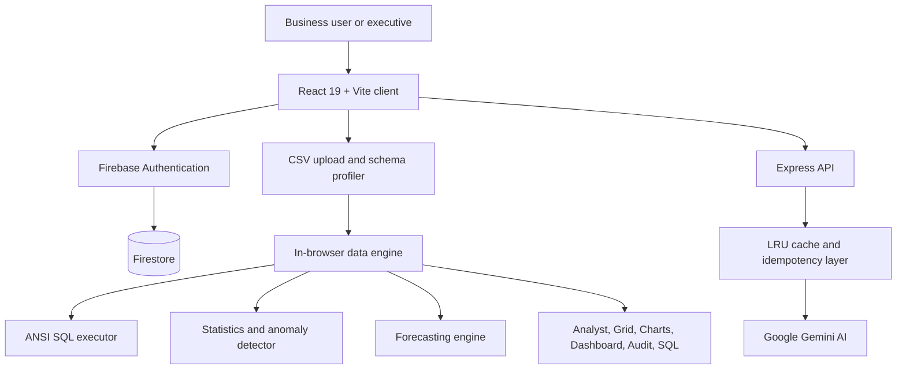

# DigitalBackOffice AI Architecture

## System Overview

## Runtime Boundaries

- **Client:** React components own navigation, upload workflows, data visualization, SQL interaction, and executive reporting.
- **Data engine:** CSV parsing, profiling, SQL execution, statistics, anomaly detection, and forecasting run in memory in the browser.
- **Server:** Express exposes AI and operational endpoints, with cache and idempotency controls for repeated requests.
- **Identity and persistence:** Firebase Authentication handles Google or demo access. Firestore provides authenticated session and application data storage.
- **Deployment:** Vercel serves the built Vite application. Docker packages the same frontend and Express runtime for self-hosted deployment.
